<div align="center">

# 🛡️ VisionShield

### AI-Based Foundry Monitoring System

**Real-time sensor monitoring · AI PPE safety detection · SOP process verification**


-00FFFF?logo=yolo&logoColor=black)


**[▶ Watch the narrated demo (4:41)](Demo_Output/recording/VisionShield_Demo_Narrated.mp4)** · **[Test report](Demo_Output/reports/TEST_REPORT.md)**

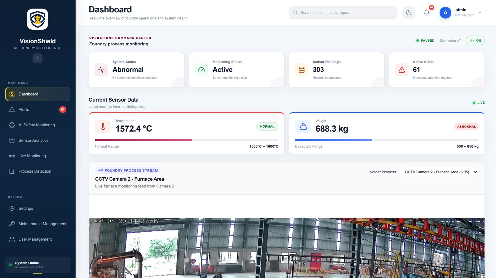

</div>

---

## 📖 Overview

Foundries make high-quality metal parts, but every casting must follow a strict sequence of steps — weighing scrap, charging the furnace, melting, adding magnesium, pouring — while workers wear the right protective equipment (PPE). Doing this by manual observation is slow and error-prone: skipped steps hurt product quality and safety violations can go unnoticed.

**VisionShield** is a full-stack web application that watches the process for the supervisor. It combines **computer vision** (YOLOv8 models run on recorded or CCTV video) with **sensor monitoring** (temperature and weight) to:

- detect workers and PPE and report compliance,
- recognise each manufacturing step and **verify the SOP order**, including the *mandatory magnesium treatment*,
- raise **real-time alerts** (dashboard, database and e-mail) when something goes wrong,
- keep every reading, alert and result in **MongoDB** for traceability and reports.

> Built as the B.Tech final-year project of **Group G49**, Department of Computer Science and Engineering, D. Y. Patil College of Engineering and Technology (DYPCET), Kolhapur — academic year 2026–27.

## ✨ Key Features

| Area | What it does |
|---|---|
| 🔐 **Authentication & roles** | Secure login with three roles — **Administrator**, **Supervisor**, **Operator** — and a menu that adapts to the role |
| 📊 **Dashboard** | System status, monitoring status, stored readings, active alerts, current temperature / weight against their limits, and an embedded CCTV stream |
| 🚨 **Alert management** | Automatic *High / Low Temperature* and *High / Low Weight* alerts, active and resolved tabs, status and resolved-date filters, one-click resolve with the resolver recorded |
| 🦺 **AI Safety Monitoring** | Upload an image or video; the YOLOv8 model detects persons, helmets, vests, boots, gloves, goggles and caps with confidence scores and returns an annotated result |
| 📈 **Sensor Analytics** | Every stored temperature / weight reading with its status and timestamp |
| 📡 **Live Monitoring** | Service health (sensor, camera, API, database), multi-camera video panels, process stage, and real-time trend charts with the configured limits |
| 🏭 **Process Detection** | Upload a casting-process video; three trained models run as a background job and the system validates the **SOP step order**, flags out-of-order or missing steps and produces an annotated output video and a downloadable report |
| ⚙️ **Settings** | Temperature / weight thresholds, data-refresh interval, start/stop monitoring, e-mail / SMS alert configuration |
| 🛠️ **Maintenance management** | Equipment maintenance records with due-soon and overdue tracking |
| 👥 **User management** | Create users, change roles and status, reset passwords |

## 🧠 How the AI Works

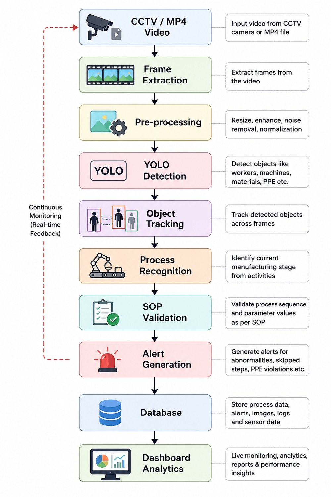

1. **Video input** — CCTV or recorded MP4 → frames are extracted and pre-processed with OpenCV.
2. **PPE detection** — a custom-trained YOLOv8 model (`backend/ai/best.pt`) detects `person, helmet, vest, boots, gloves, goggles, cap`; Ultralytics' multi-object tracker keeps object IDs across frames when processing video.
3. **Process recognition** — three further YOLOv8 models (in `backend/ai/process_models/`) recognise the manufacturing steps:

   | SOP step | Model | Mandatory |
   |---|---|---|
   | 1. Scrap weighing | `scrap_weighing_best.pt` | – |
   | 2. Furnace charging | `furnace_charging_best.pt` | – |
   | 3. Magnesium process | `magnesium_process_best.pt` | **Yes** |

   Detections are smoothed over a window of 8 frames so single-frame noise does not trigger false steps.
4. **SOP validation** — the order of steps is checked; *out-of-order* steps and a *missing magnesium step* raise alerts (a missing mandatory step is saved as a **Critical** alert in MongoDB and can trigger an e-mail).
5. **Output** — an annotated video with SOP progress, per-step frame counts / coverage, and a downloadable report.

## 🏗️ System Architecture

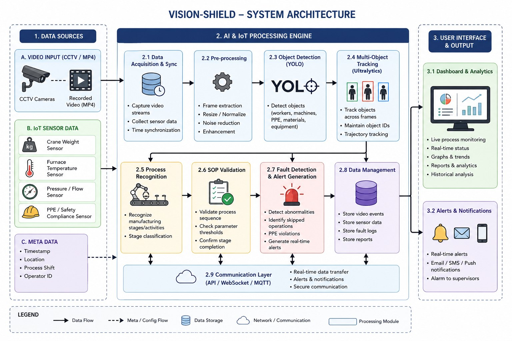

```
React dashboard  ⇄  FastAPI REST API  ⇄  MongoDB Atlas
                         │
                         ├── YOLOv8 PPE model        (images / video)
                         ├── 3 × YOLOv8 process models (SOP validation, background jobs)
                         ├── Sensor monitor / simulator (temperature & weight)
                         └── Notifier (e-mail / SMS / Telegram alerts)
```

The project is organised into **five modules**:

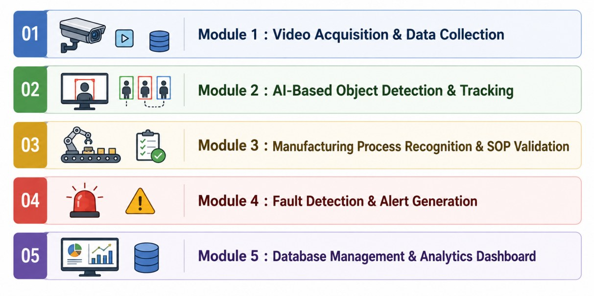

## 🖼️ Screenshots

| | |
|---|---|
| 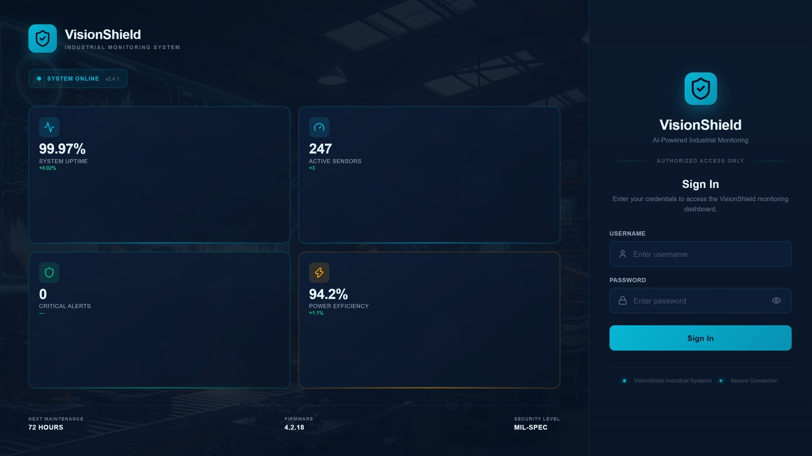 **Login** |  **Dashboard** |
| 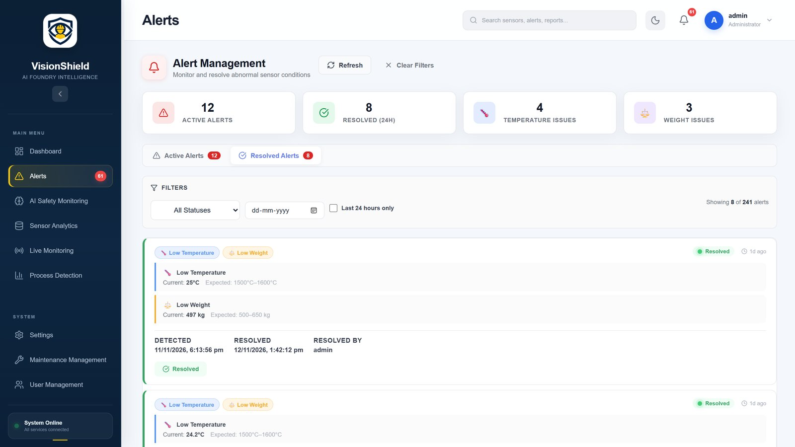 **Alert management** | 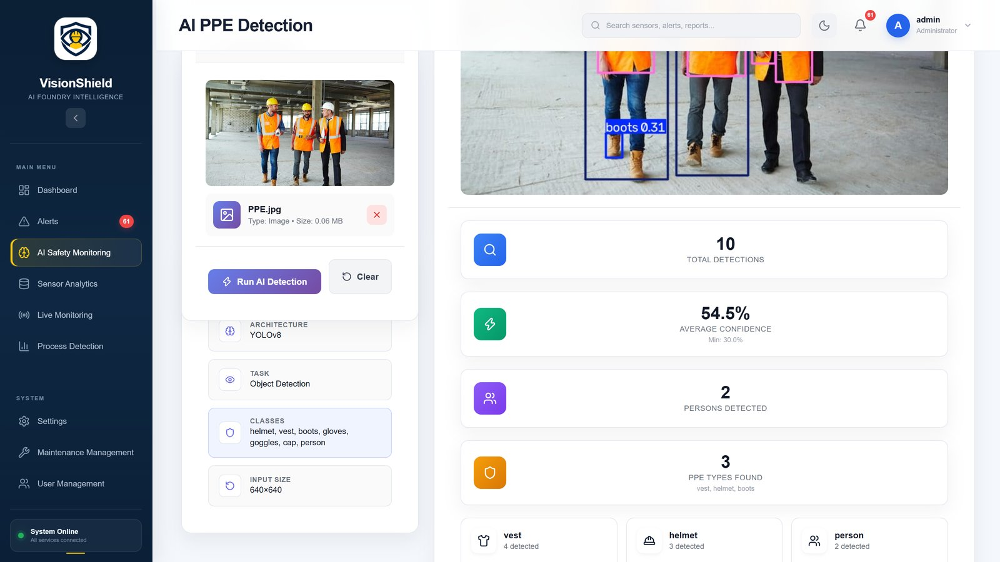 **AI PPE detection** |
| 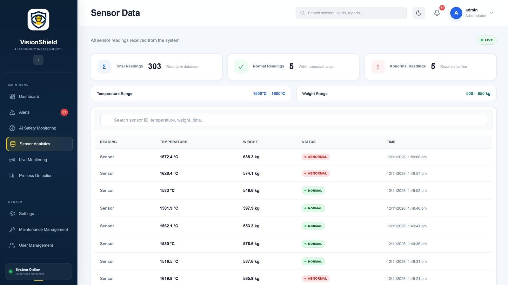 **Sensor analytics** | 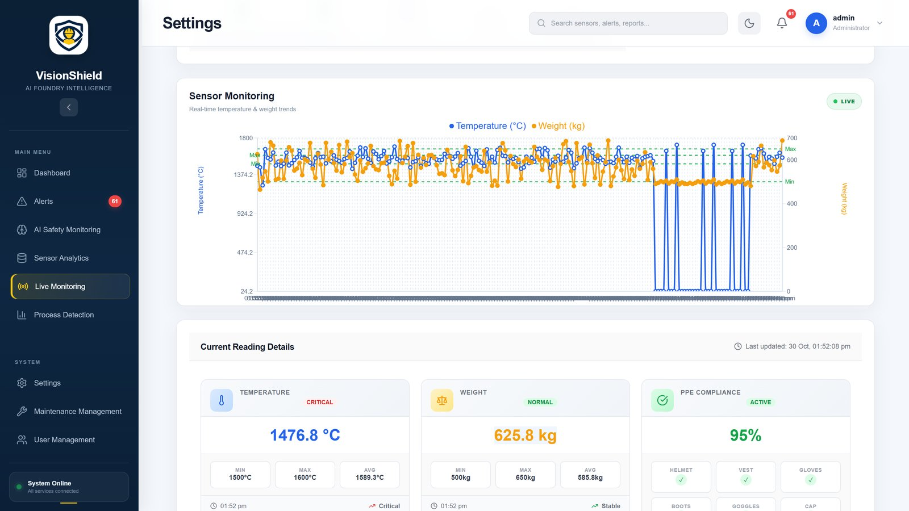 **Live monitoring** |
| 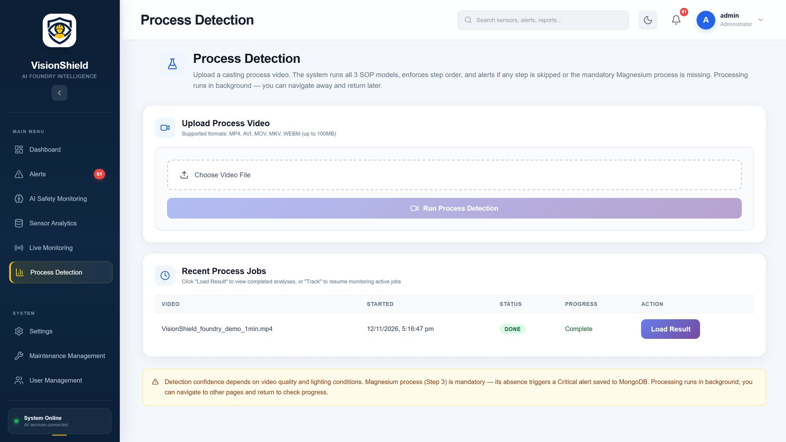 **Process video upload** | 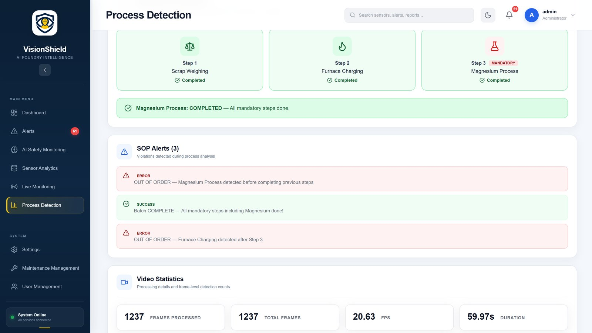 **SOP result** |
| 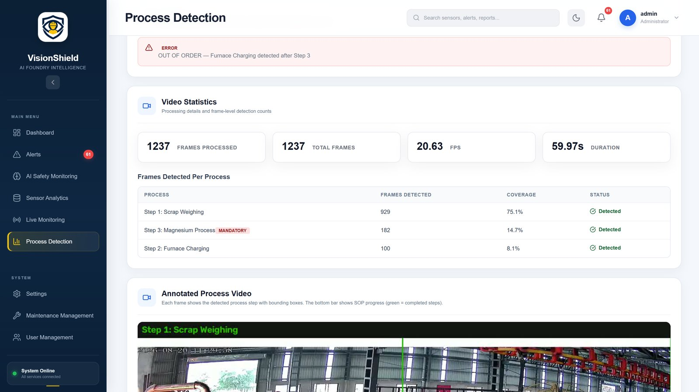 **SOP alerts & statistics** | 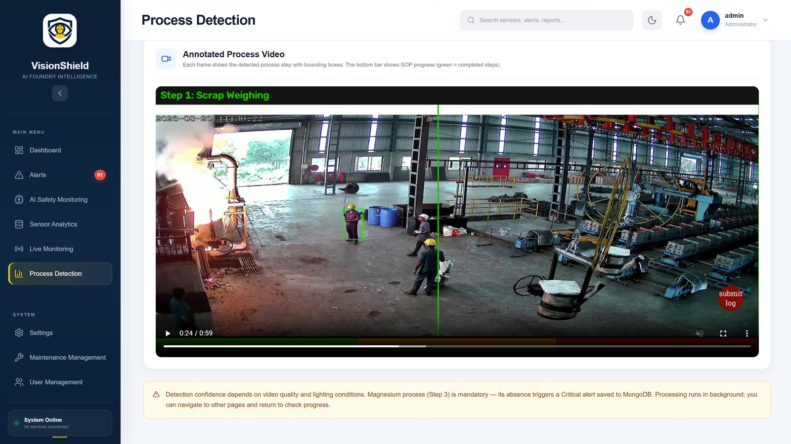 **Annotated output video** |
| 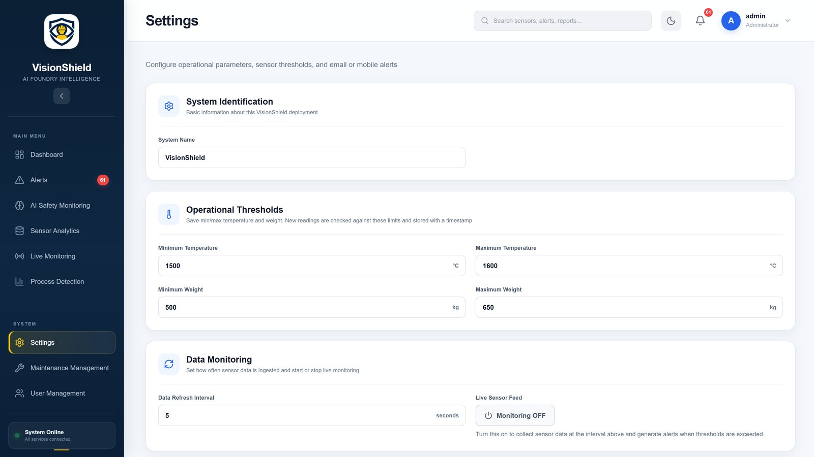 **Settings** | 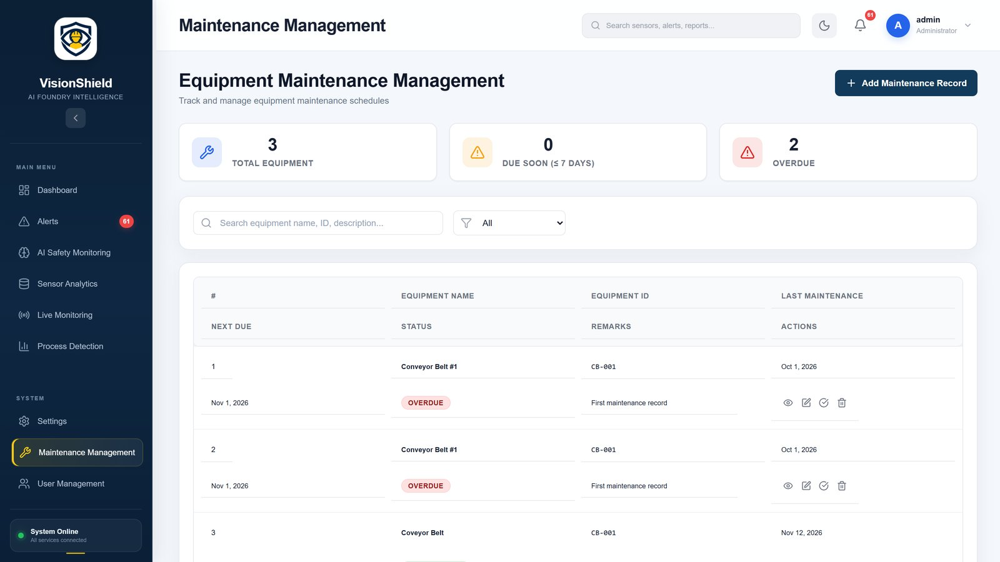 **Maintenance** |
| 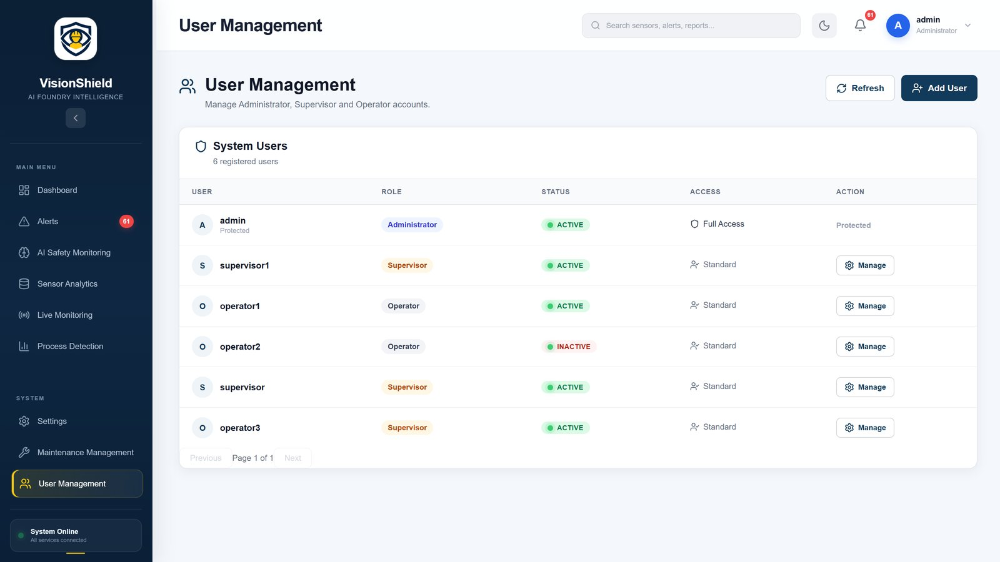 **User management** | |

## 🧰 Tech Stack

| Layer | Technology |
|---|---|
| Frontend | React 19, Vite, Recharts, Axios, Lucide icons |
| Backend | Python 3.13, FastAPI, Uvicorn, Pydantic |
| Database | MongoDB Atlas (PyMongo) |
| AI / Vision | Ultralytics YOLOv8, PyTorch, OpenCV, imageio-ffmpeg |
| Reports & alerts | ReportLab (PDF reports), SMTP e-mail, optional SMS / Telegram |
| Security | Argon2 password hashing (pwdlib), role-based session tokens |

## 📁 Project Structure

```
VisionShield/
├── backend/
│   ├── main.py                  # FastAPI app: auth, sensors, alerts, AI, process jobs, maintenance
│   ├── auth.py  database.py  notifier.py  sensor_monitor.py  sensor_simulator.py
│   ├── ai/
│   │   ├── best.pt              # PPE model
│   │   ├── process_models/      # 5 trained process models (3 used for the SOP check)
│   │   ├── ppe_detector.py  video_detector.py  process_detector.py
│   ├── simulator/               # CSV sensor simulator
│   ├── requirements.txt
│   └── .env.example             # copy to .env and fill in your own values
├── frontend/
│   ├── src/pages/               # Login, Dashboard, Alerts, AIUpload, SensorData, LiveMonitoring,
│   │                            # ProcessDetection, Settings, MaintenanceManagement, UserManagement
│   ├── src/config/              # api.js (API base URL), videos.js (demo video list)
│   └── public/videos/           # demo videos for the dashboard players
├── Demo_Output/                 # narrated demo video, 1-minute test clip, test report, poster, tools
├── docs/                        # screenshots and diagrams used in this README
└── README.md
```

## 🚀 Getting Started

### Prerequisites
- **Python 3.13** (3.10+ should work) and **Node.js 20+**
- A **MongoDB Atlas** cluster (free tier is enough) and a database user
- Optional: an NVIDIA GPU (CPU works, but processing a 1-minute video takes a few minutes)

### 1. Backend
```bash
cd backend
python -m venv .venv
# Windows:  .venv\Scripts\activate        macOS/Linux:  source .venv/bin/activate
pip install -r requirements.txt
cp .env.example .env          # then put your own MongoDB user / password (and optional alert settings)
```
Point `database.py` at **your** cluster (the `MONGODB_URL` host) — the database name is `VisionShieldDB`. Then:
```bash
uvicorn main:app --host 127.0.0.1 --port 8000
```
Interactive API docs: <http://127.0.0.1:8000/docs> · health check: `GET /api/test`, `GET /api/database-test`.

Create the first administrator with the setup endpoint (`POST /api/auth/setup`, visible in the API docs) and then log in from the web app.

### 2. Frontend
```bash
cd frontend
npm install
npm run dev                  # http://localhost:5173
```
The API address is set in `frontend/src/config/api.js` (default `http://127.0.0.1:8000`).

### 3. Try Process Detection
Open **Process Detection**, choose `Demo_Output/video/VisionShield_foundry_demo_1min.mp4` and click **Run Process Detection**. The job runs in the background; when it finishes you will see the SOP step sequence, SOP alerts, video statistics and the annotated output video.

### Notes
- **Sensor data:** the *Live Sensor Feed* switch in **Settings** generates simulated temperature / weight readings at the chosen interval (ESP32 hardware integration is planned). `backend/simulator/csv_simulator.py` can replay readings from a CSV.
- **Video panels:** the dashboard and Live Monitoring play the clips listed in `frontend/src/config/videos.js`. Two small clips are included in `frontend/public/videos/`; add your own MP4s there (H.264 / AAC recommended — see `REENCODE_VIDEOS.md`).
- **Large test videos** are intentionally not in the repository.

## 🔌 API Overview

| Group | Endpoints (prefix `/api`) |
|---|---|
| Auth & users | `auth/login`, `auth/setup`, `auth/users`, `auth/users/role`, `auth/users/status`, `auth/users/password` |
| Sensors & alerts | `sensors`, `sensors/history`, `alerts`, `alerts/resolve`, `reports/daily` |
| Settings | `settings`, `settings/runtime`, `settings/monitoring`, `test-notification` |
| AI safety | `ai/detect` (image), `ai/video-detect`, `ai/result/{file}`, `ai/video-result/{file}` |
| Process detection | `process/video-detect`, `process/status/{job}`, `process/result/{job}`, `process/video-result/{file}`, `process/jobs`, `process/download-report/{job}`, `process/cancel/{job}` |
| Maintenance | `maintenance`, `maintenance/{id}`, `maintenance/{id}/complete`, `maintenance/stats/summary` |

## ✅ Testing

32 test cases were designed across the five modules; **24 have been executed with recorded evidence and all 24 passed (0 failed)**, 8 remain pending (they need extra test data or accounts). Highlights: unsupported-file rejection, confidence filtering, tracker ID persistence, SOP out-of-order detection, boundary-value checks on the temperature / weight limits, e-mail alert delivery, role-based access and alert date filtering.
Details and evidence: [`Demo_Output/reports/TEST_REPORT.md`](Demo_Output/reports/TEST_REPORT.md).

## 🔮 Future Work
- Connect live RTSP / CCTV cameras and real ESP32 weight and temperature sensors
- Evaluate model accuracy (mAP, precision, recall) on a labelled test set and retrain on more factory footage
- Buzzer / push-notification integration and deployment to the plant network

## 👩‍💻 Team G49

| Member | Module |
|---|---|
| Snehal Sunil Wagavekar | Module 1 – Video acquisition & data collection |
| Sanika Vijay Gurav | Module 2 – AI-based object detection & tracking |
| Shweta Rajendra Vhannure | Module 3 – Manufacturing process recognition & SOP validation |
| Sufiya Balaso Bargir | Module 4 – Fault detection & alert generation; testing, documentation, demo video, presentation, poster, repository |
| Samiksha Vinod Gaikwad | Module 5 – Database management & analytics dashboard |

**Project guide:** Mr. Niraj A. Haval · **Department of Computer Science and Engineering, DYPCET, Kolhapur**

---

<div align="center"><sub>⚠️ Never commit your <code>.env</code> file — it holds database and alert credentials. Only <code>.env.example</code> belongs in the repository.</sub></div>
